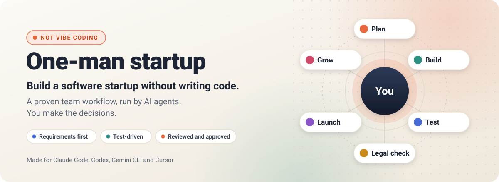
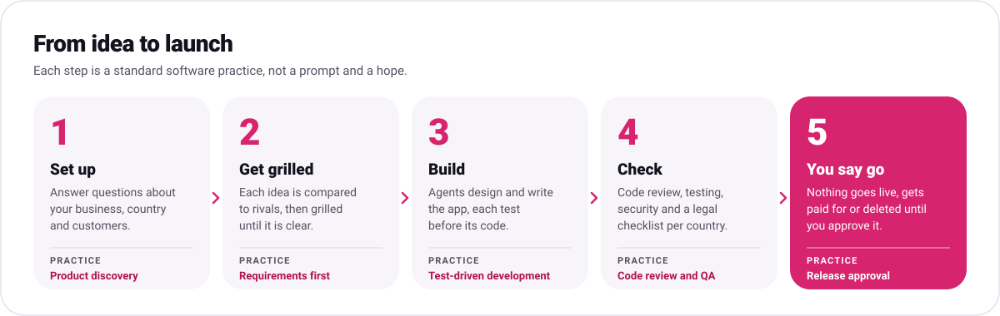
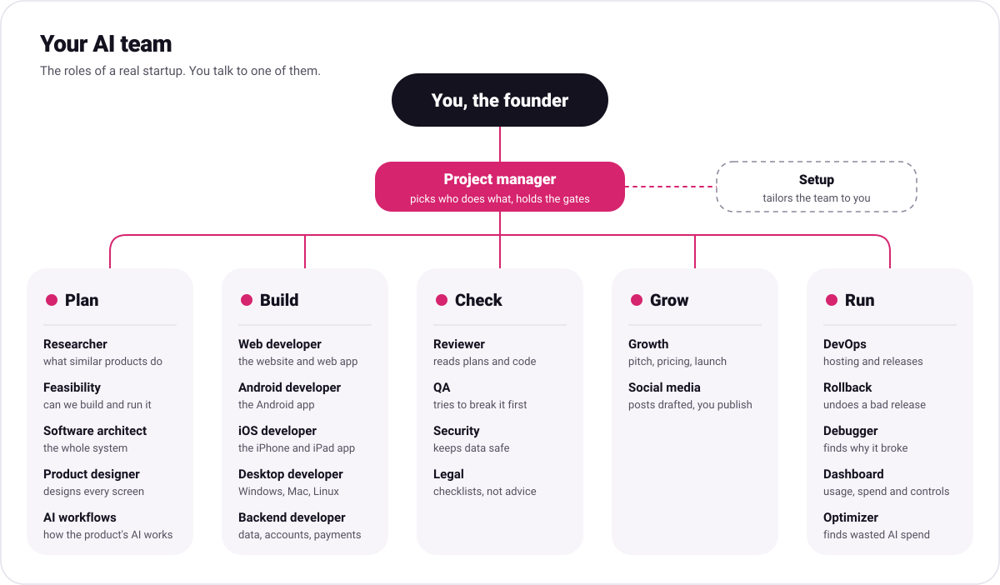
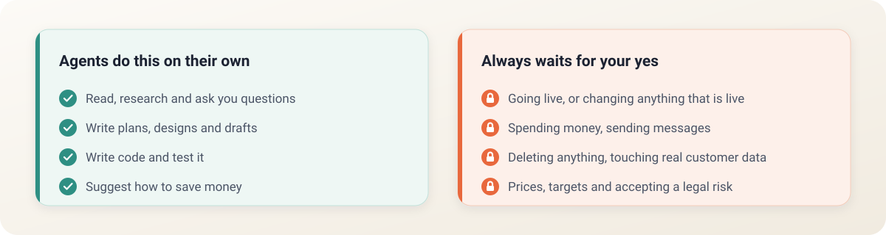
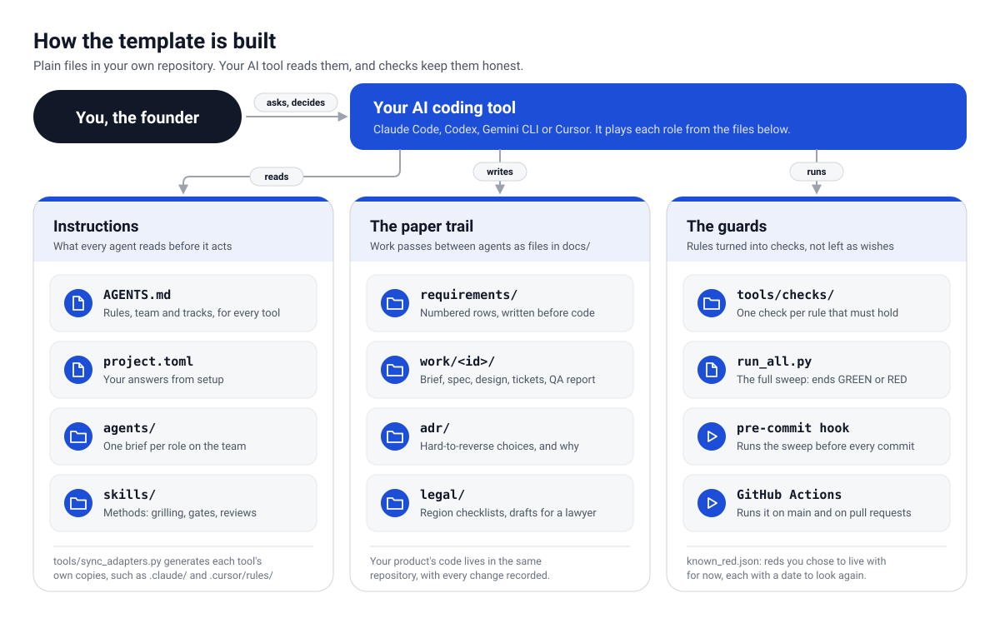

  

# One-man startup

**Build a software startup without writing code.**

You have an idea for an app or an online business, and no one to build it. This template gives
you a small team of AI agents that plan, build, test and launch it with you. You never write
code, and you don't need to read it. You need to know your customers and be willing to make
decisions. It is not vibe coding: the agents follow the workflow real software teams use, and
nothing goes live without your yes.

  <a href="docs/START-HERE.md"><b>Start here: the step-by-step guide</b></a>
  &nbsp;&middot;&nbsp;
  <a href="examples/setup-dry-run/">See a recorded setup</a>
  &nbsp;&middot;&nbsp;
  <a href="https://fadi88.github.io/one-man-startup/">Website</a>

## See it

Setup at work, replayed word for word from a [recorded dry run](examples/setup-dry-run/) with
a fictional founder. The full transcript and every file it wrote are there.

## How it goes

1. **Set up.** The project manager interviews you: what you're building, for whom, in which
   countries, what data you'll hold, your monthly AI budget, your code's licence, and how
   technical you are, so every agent talks to you at your level. Each question comes with a
   suggested answer, so you can say yes where you have no opinion.
2. **Get grilled.** Every new feature starts with the questions a sharp product manager would
   ask. A researcher first looks at what similar products do, and afterwards a feasibility check
   confirms it can be built and run within your budget. Ask for one on any idea: *"grill me on
   this"*.
3. **Build.** A designer draws every screen, and developers build the web, phone and desktop
   apps you need, each test written before its code.
4. **Check.** A reviewer reads every plan and code change, a tester tries to break it, a
   security reviewer looks for leaks, and the legal agent checks each country you sell in.
5. **You say go.** Nothing goes live until you've seen what changed and approved it. If a
   release goes wrong, the last good version goes back first, on your word.

## Your team

You talk to one agent, the project manager, in your own words; it brings in the others. Setup
switches on only the ones your project needs now, and the reviewer suggests more as the
project grows.

## What stays in your hands

The agents can be wrong, and sometimes confidently wrong, so there is a check at every step:

- **Write it down first.** Every feature is described in plain words before any code exists.
- **Prove it works.** Every change is tested, and the agents report what they could not test.
- **Nothing irreversible without you.** Going live, payments, messages to customers and
  deleting data wait for your approval, one step at a time.
- **Decisions are recorded,** with the reason, so they aren't argued again next week.

## Getting started

| You need | What it is | Cost |
|---|---|---|
| An AI coding tool | Claude Code, Codex, Gemini CLI or Cursor. The template is written for all four; see [what has been tested](docs/ASSUMPTIONS.md). | A paid subscription. Check the tool's own pricing page. |
| A GitHub account | Where your project's files are kept, with every change recorded. | Free |
| Git and Python | Two free programs the checks use. The project manager checks for them and walks you through installing them. | Free |

Then follow **[Start here](docs/START-HERE.md)**, a guide with screenshots and no code: copy
the template on GitHub, install Claude Code, open your copy and say hello. Hosting your app once
it's live has its own costs; the agents tell you what each option costs before you choose.

## This is not vibe coding

Vibe coding means describing what you want to an AI, accepting whatever it writes, and asking
again when something breaks. It is fast for a demo, and tends to end in an app that half works,
that nobody understands, and that gets more fragile with every fix.

Here the AI agents fill the roles and the workflow is the traditional one. Every step has a
standard name you can look up:

| What happens here | The established practice |
|---|---|
| Before you are interviewed, a researcher looks at what similar products already do, with sources. | Competitive analysis |
| Before anything is built, you are interviewed about who needs it, the smallest useful version and what happens when it goes wrong. | Requirements elicitation and product discovery |
| Everything the product must do is written as a numbered requirement, and every change names the requirement it serves. | Requirements traceability |
| After the interview, a feasibility check confirms it can be built and run on your stack and budget. | Feasibility study |
| Building can't start until the spec is confirmed and no question on it is still open. | Definition of Ready |
| An architect designs the system and records each hard-to-reverse choice with its reason. | Architecture Decision Records |
| Developers write the test before the code. | Test-driven development |
| A reviewer reads every spec, design and code change before it moves on. | Code review |
| A separate tester checks the work against the requirements and can stop a release. | Independent QA and a release gate |
| If a release breaks something important, the last good version goes back first and the cause is found after. | Incident response and rollback |
| A security reviewer looks for ways data could leak or be misused. | Security review and threat modelling |
| Every change re-runs every check, and a round of work ends only when they all pass. | Continuous integration |
| Nothing goes live, costs money or deletes data without your approval, one step at a time. | Change approval and release management |
| Decisions, and the ideas you turned down, are written down with the reason. | Decision log |

What changes is who does the work, not how it is done. You play the founder and the final
approver; the agents play the team.

## Who it's for

- You have a business idea and no technical co-founder.
- You've tried vibe coding and ended up with something that half works and that nobody can
  maintain.
- You want to understand what is being built and why, without learning to program first.

Developers who work alone can use it too, for the discipline of a team without hiring one.

## Good to know

**It isn't magic.** The agents are good at a lot of work and still make mistakes. The tests and
approvals catch many of them before they reach you, not all. They won't catch a bad business
idea either; the grilling is there for that.

**It isn't legal advice.** The legal agent writes checklists and first drafts of your privacy
policy and terms, marked for a lawyer. Before launching, especially with payments, health data,
children or financial data, have a lawyer review them. You'll arrive with specific questions
instead of a blank page.

**Free tiers are strict.** If your product has a free plan or a trial, the agents build hard
limits into it from the first version: a cap per user, a tighter one for people who haven't
signed up, and a daily ceiling on what the free plan can spend in total. You choose the numbers.
Without limits, anyone who finds the free plan, including bots, can run up your bill.

**You can see and control what your product spends.** The dashboard agent builds a private page,
only for you, with users, sign-ups, errors and revenue, and, if your product uses AI, its usage
and cost per user, per feature and in total against your limits and budget. From the same page
you can change a limit, pause the free plan or a feature, block a user or switch to a cheaper
model without a new release. Every change asks you to confirm, is logged, and can be undone.

**Costs can add up.** Every agent run uses your AI subscription. The optimizer agent looks for
waste, such as an agent using a stronger model than its job needs, and suggests savings. You
approve each one.

**You can stop any time.** Everything the agents make is ordinary code and documents in your own
GitHub repository. Nothing is locked into this template or any one AI tool.

## Words you'll see

| Word | Meaning |
|---|---|
| Repository | Your project's folder, kept on GitHub with a full history of changes. |
| Commit | A saved change, with a note about what changed and why. |
| Requirement | One sentence describing something the product must do, written before it's built. |
| Test | A small automatic check that something works. It's run again after every change. |
| Deploy | Putting a new version live for your users. Always waits for you. |
| Agent | An AI with one job, like a team member with a role. |

## How it's built

Everything is plain files in your own repository. Your AI tool reads the instructions, leaves a
written record of every step in `docs/`, and runs the checks that keep the rules from being
skipped. For developers: how the agents, skills, checks and tool adapters fit together is in
[docs/HOW-IT-WORKS.md](docs/HOW-IT-WORKS.md), and the operating manual the agents follow is
[AGENTS.md](AGENTS.md).

## Credits

This template borrows ideas, with thanks, from:

- Matt Pocock's [grilling skill](https://github.com/mattpocock/skills)
- Andrej Karpathy's observations on LLM coding pitfalls, as turned into guidelines in
  [forrestchang/andrej-karpathy-skills](https://github.com/forrestchang/andrej-karpathy-skills),
  included unchanged under its MIT licence
- GitHub's [spec-kit](https://github.com/github/spec-kit)
- Anthropic's [frontend-design skill](https://github.com/anthropics/claude-plugins-official/tree/main/plugins/frontend-design), included unchanged under the Apache License 2.0
- the five specification layers of Hamidreza Saghir, as adapted in Florian Bruniaux's
  [Claude Code guide](https://github.com/FlorianBruniaux/claude-code-ultimate-guide), rewritten
  here as the spec audit
- the [BMAD Method](https://github.com/bmad-code-org/BMAD-METHOD)
- Garry Tan's [gstack](https://github.com/garrytan/gstack)
- Addy Osmani's [agent-skills](https://github.com/addyosmani/agent-skills): the performance
  and observability disciplines, the floor check, schema expand-and-contract, the contract and
  test rules, rewritten here for this team (MIT)
- Anthropic's writing on [multi-agent systems](https://www.anthropic.com/engineering/multi-agent-research-system)
  and its [legal plugin](https://github.com/anthropics/knowledge-work-plugins/tree/main/legal)

MIT licence. Use it, change it, build your company on it.
