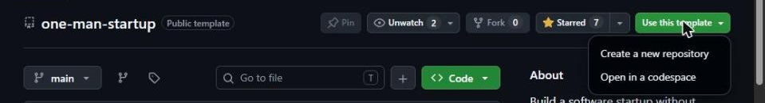
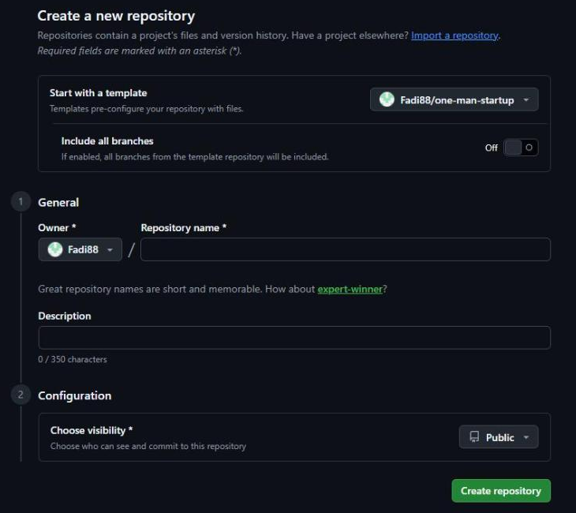
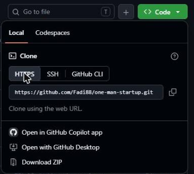
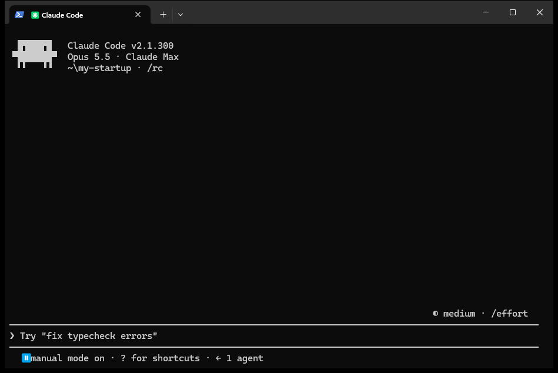
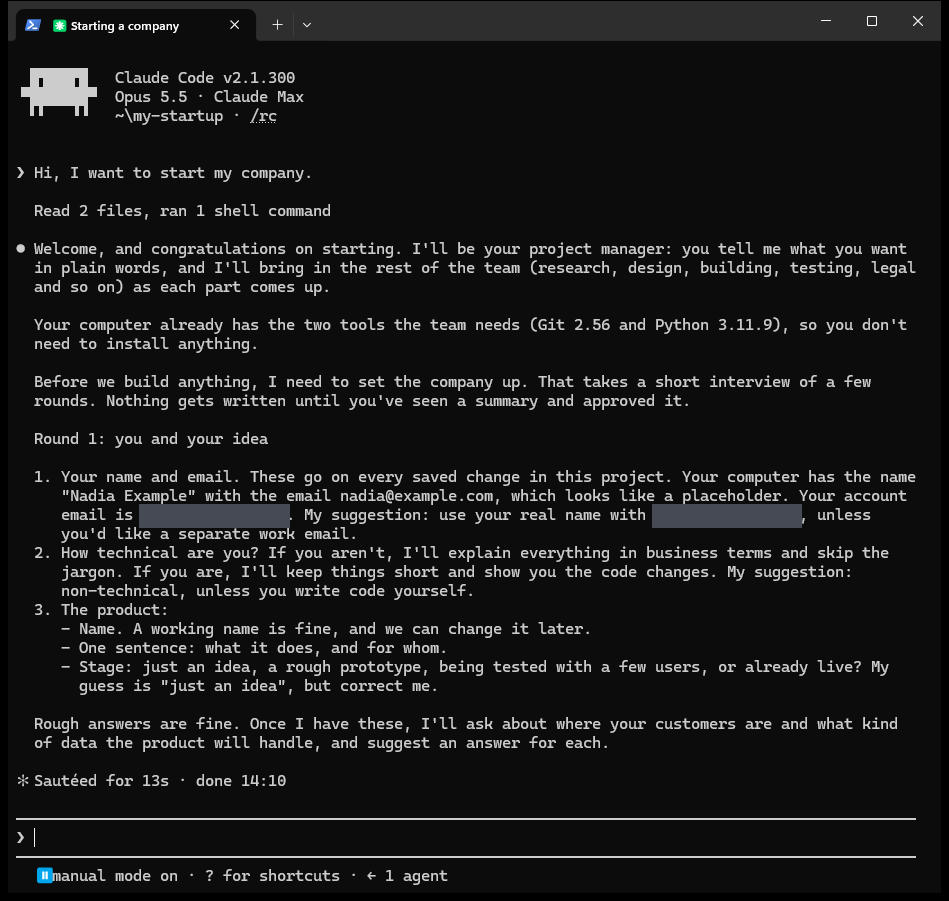

# Start here

This guide takes you from nothing to talking with your AI team. You don't need to write code.
You will type exactly two things into a terminal, both shown below; after that, you just talk.

You will talk to one agent only: **the project manager**. Everything else (the interview, the
other agents, the checks) it runs for you.

## What you need

- **A GitHub account** (free). Sign up at [github.com](https://github.com/signup). GitHub keeps
  your project's files and every change ever made to them.
- **A paid Claude plan** (Pro, Max, Team or Enterprise); the free plan does not include Claude
  Code. Check the current plans and prices at [claude.com/pricing](https://claude.com/pricing).

## 1. Make your own copy

On the [template's page](https://github.com/Fadi88/one-man-startup), click **Use this
template**, then **Create a new repository**.

Give it your product's name, and choose **Private** under visibility unless you want everyone to
see your work. Then click **Create repository**.

## 2. Get it on your computer

1. Install **GitHub Desktop** from [desktop.github.com](https://desktop.github.com) and sign in
   with your GitHub account.
2. On your new repository's page on GitHub, click the green **Code** button, then **Open with
   GitHub Desktop**.

   

3. GitHub Desktop shows where it will save the folder (the *Local path*). Note it, then click
   **Clone**.

## 3. Install Claude Code

A terminal is a window where you type instructions to your computer. If you have never opened
one, Anthropic's [terminal guide](https://code.claude.com/docs/en/terminal-guide) shows how.

Open **PowerShell** on Windows (search for it in the Start menu) or **Terminal** on a Mac, paste
the line for your computer and press Enter:

- Windows: `irm https://claude.ai/install.ps1 | iex`
- Mac: `curl -fsSL https://claude.ai/install.sh | bash`

It shows no progress while it downloads. When it finishes, close the window. These commands come
from Anthropic's [install page](https://code.claude.com/docs/en/setup), which has help if
something goes wrong.

## 4. Open your project and say hello

1. In GitHub Desktop, open the **Repository** menu and choose the option to open the repository
   in a terminal (on Windows it names your terminal, such as Command Prompt or PowerShell).
2. Type `claude` and press Enter. The first time, it opens your browser so you can sign in to
   your Claude account. If it asks whether you trust this folder, say yes: it is your own
   project.

   

3. Type anything, for example *"Hi, I want to start my company."*, and press Enter.

The project manager answers. Because it's a new project, it checks that your computer has the two
free programs the checks need (Git and Python) and offers to help install whatever is missing.
Then it starts **the setup interview**: questions about you, your product, your customers and
your countries, each with a suggested answer, so you can say yes when you have no opinion.

*A real first reply, on a copy with a made-up founder (Nadia Example). The grey boxes hide the
email address of the account used to take the screenshot.*

Before it runs a command or changes a file, Claude Code shows what it wants to do and asks.
Say yes when it matches what you asked for; say no and explain when it doesn't. When the
interview ends, the project manager shows you what it wrote down and waits for you to confirm.

## 5. Ask for what you want

From then on, say what you want in your own words, to the same project manager:

- *"I want a landing page where people can join a waiting list."*
- *"Grill me on this idea: ..."*
- *"What would it cost to add payments?"*
- *"Show me what changed since yesterday."*

You never need to know which agent does what. The project manager picks them, tells you who is
working on what, and comes back to you for every decision: anything that goes live, costs money,
deletes something or sends a message waits for your yes.

## If something goes wrong

Tell the project manager what you see, in plain words, or paste the message. If you're stuck
before you get that far, the [worked example](../examples/setup-dry-run/) shows a full setup
interview, word for word.

## Using another tool

Prefer not to use a terminal? Claude's desktop app has a Code tab that opens a folder the same
way; it has not been tested with this template yet. The template is also written for Codex,
Gemini CLI and Cursor: open your folder in the tool and say hello, as in step 4. See
[what has been tested](ASSUMPTIONS.md).
